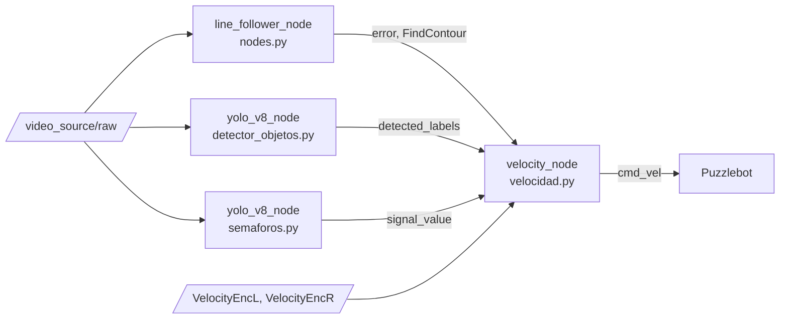

# Puzzlebot: autonomous line following with traffic-sign and traffic-light detection

A ROS2 stack for the Puzzlebot differential-drive robot. It follows a track with a camera, reads traffic signs and traffic lights with two custom-trained YOLOv8 models, and adjusts speed and direction to match.

Final project for a robotics course at Tecnológico de Monterrey (2024).

<!-- Add a demo here: record the robot on the track and save it as docs/demo.gif -->
<!--  -->

## What it does

- **Line following:** thresholds a region of interest in the camera image, finds the line centroid, and steers with a proportional controller on the pixel error.
- **Traffic lights:** red stops the robot, yellow cuts speed to 50%, green drives at full speed.
- **Traffic signs:** at intersections (where no line is visible) the robot acts on the sign it detects:
  - `turnleft_sgl`: turns left about 120°, measured with wheel-encoder odometry
  - `round_sgl`: takes the roundabout, turning right about 145°
  - `straight_sgl`: crosses the intersection straight
  - `stop_sgl`: stops, then continues
  - `workers_sgl`: slows down while following the line

## Architecture



| File | Node | Subscribes | Publishes |
|---|---|---|---|
| `nodes.py` | `line_follower_node` | `video_source/raw` | `error`, `FindContour`, `processed_img` |
| `detector_objetos.py` | `yolo_v8_node` | `video_source/raw` | `detected_labels` |
| `semaforos.py` | `yolo_v8_node` | `video_source/raw` | `signal_value` |
| `velocidad.py` | `velocity_node` | `error`, `FindContour`, `detected_labels`, `signal_value`, `/VelocityEncL`, `/VelocityEncR` | `cmd_vel` |

| Model | Detects |
|---|---|
| `best_actualizado.pt` | Traffic signs |
| `best_semaforo.pt` | Traffic lights |

## Requirements

- ROS2 with `rclpy` and `cv_bridge`
- Python packages: `opencv-python`, `numpy`, `ultralytics`
- A Puzzlebot (or any robot) that publishes camera frames on `video_source/raw` and wheel speeds on `/VelocityEncL` and `/VelocityEncR`

## Running

1. Clone the repo onto the robot:
   ```bash
   git clone https://github.com/jpcedano/puzzlebot.git
   cd puzzlebot
   ```
2. Point the two YOLO nodes at the model files. `detector_objetos.py` and `semaforos.py` load them from a hardcoded path (`/home/puzzlebot/proyecto_final/...`). Change it to where the `.pt` files are on your machine.
3. With the camera and motor drivers running, start each node in its own terminal:
   ```bash
   python3 nodes.py
   python3 detector_objetos.py
   python3 semaforos.py
   python3 velocidad.py
   ```

## Known limitations

- The model paths are hardcoded, and the nodes are standalone scripts rather than a ROS2 package with a launch file.
- The `straight` and `stop` maneuvers run in blocking loops inside the timer callback, so the node can't react to new detections until they finish.
- Turns are open-loop apart from encoder odometry, so their accuracy depends on wheel slip and calibration (wheel radius 0.05 m, track width 0.19 m in `velocidad.py`).
